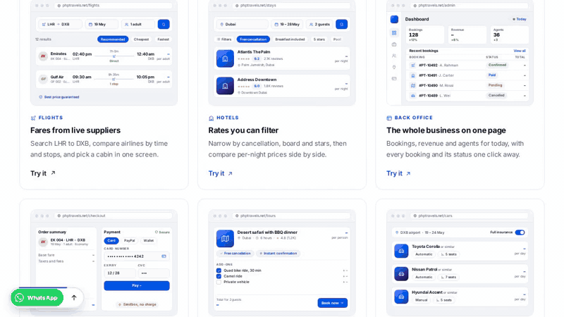

# TestScribe

**Write a browser test in plain English. Get a checked result and evidence.**



*A real PHPTravels run: TestScribe opened the flight demo, searched DEL to PNQ for 10 November 2026, and passed after finding visible “Book Now” buttons. The last frame shows the saved result screenshot.*

TestScribe turns a test such as “Enter TestScribe in the text field, submit, and verify that Received! appears” into browser actions. An AI model plans the actions; Playwright finds controls on the live page and checks the expected result. Run it from the terminal, the [VS Code chat extension](vscode-extension/README.md), or an MCP-capable coding agent. Tests are not tied to one website.

[](https://github.com/Tchaikovsky29/TestScribe/actions/workflows/verify.yml)

## Try it from the terminal

You need Python 3.10+, Git, cURL, and a model API key. The example below uses Gemini, which has a [free tier](https://ai.google.dev/gemini-api/docs/pricing). BharatCode is the default provider; Groq is also supported.

```bash
git clone https://github.com/Tchaikovsky29/TestScribe.git
cd TestScribe
python3 -m venv .venv
source .venv/bin/activate
python -m pip install -e .
python -m playwright install chromium
cp .env.example .env
```

Put your key in `.env` as `GEMINI_API_KEY=your-key`. Get one from [Google AI Studio](https://aistudio.google.com/app/apikey). The `.env` file is ignored by Git. On Windows, create the environment with `py -3 -m venv .venv`, activate it with `.venv\Scripts\activate`, and copy `.env.example` to `.env`.

```bash
testscribe run --provider gemini --case-file examples/web-form-pass.json
```

The example opens [Selenium's public web form](https://www.selenium.dev/selenium/web/web-form.html), enters text, submits, and checks for `Received!`. A successful run prints `PASS` and the path to `report.json`. It also saves `pass.png` as evidence. Try `examples/web-form-fail.json` to see a deliberately false expectation return `FAIL`.

If Chromium is missing, run `python -m playwright install chromium` again. On Linux, if it cannot start because system libraries are missing, run `python -m playwright install --with-deps chromium`.

## Write your own test

```bash
testscribe run \
  --url https://phptravels.com/demo \
  --test 'Open the storefront from the demo page and verify a flight search option is shown.' \
  --provider gemini
```

Use a full `http://` or `https://` URL and state what should be checked. TestScribe first checks that the URL responds, then plans up to 12 actions, observes the page before each action, and verifies the final state in Chromium. The model cannot declare its own run a pass. See [Approach and limitations](approach-and-limitations.md) for the full flow and known gaps.

The command writes `artifacts/<timestamp>/report.json`. Pass `--output-dir artifacts/my-run` to choose a directory; the file will be `artifacts/my-run/report.json`. `--json` prints a compact result for scripts and agents. Exit code `0` means `PASS`; exit code `1` means `FAIL` or `BLOCKED` (the run could not be completed reliably). Argument and setup errors use exit code `2`. Run `testscribe --help` to see every flag.

## Choose a model provider

Put the matching key in `.env`, then select the provider with `--provider`:

| Provider | Key in `.env` | Command option |
| --- | --- | --- |
| BharatCode (default) | `BHARATCODE_API_KEY` | Omit `--provider`, or use `--provider bharatcode` |
| Gemini | `GEMINI_API_KEY` | `--provider gemini` |
| Groq | `GROQ_API_KEY` | `--provider groq` |

Each preset supplies a base URL, model ID, and key name. Use `--model` to pick another model, or `--base-url` and `--api-key-env` to override the connection. For another OpenAI-compatible service, use `--provider custom --base-url URL --model MODEL`; its default key name is `OPENAI_API_KEY`. Model availability, free tiers, and rate limits depend on the provider and account. The [Gemini-compatible endpoint](https://ai.google.dev/gemini-api/docs/openai) and [Groq-compatible endpoint](https://console.groq.com/docs/openai) are documented by their providers.

## Use it in VS Code

The [VS Code extension guide](vscode-extension/README.md) covers setup in a web project. In the TestScribe sidebar, enter a site URL and test, pick a model, and see the verdict, checks, browser steps, and evidence links in one chat view. Choose BharatCode, Gemini, Groq, or Custom in **TestScribe: Provider** settings. The extension uses the same Python CLI and Playwright browser, which you install separately.

## Test flows that need credentials

Put values in an ignored file such as `login.secrets.json`:

```json
{"EMAIL":"customer@example.com","_PASSWORD":"your-password"}
```

Reference them in the test as `{{EMAIL}}` and `{{_PASSWORD}}`, then pass `--vars-file login.secrets.json`. Values whose names start with `_` are inserted locally when filling browser fields and redacted from model requests and reports by exact match. Sensitive runs skip screenshots, traces, and video by default; `--allow-sensitive-artifacts` opts in. The website receives the filled values, and transformed values may evade exact-match redaction. Run `testscribe --vars-file --help` for details.

For a visible walkthrough, add `--headed --slow-mo 1000 --hold-seconds 10`. Add `--record-video` to save browser-page video. Passing runs save `pass.png` by default; `--no-pass-screenshot` turns that off. Nonpassing runs save a screenshot and trace when a page is available, unless sensitive variables suppress them. `artifacts/` is ignored by Git.

## Use it with coding agents

Install the optional MCP server with Python 3.11+ and `python -m pip install -e '.[agent]'`. Register the local stdio command `testscribe-mcp` with your agent. It exposes `start_test`, `get_test_status`, and `get_test_result`; `start_test` accepts `provider`, `case_file` or `url` and `test`, and optional model/connection overrides. Runs return an ID immediately so agents can poll for a checked verdict. MCP artifacts default to the system temporary directory under `testscribe-runs/`; set `TESTSCRIBE_ARTIFACTS_DIR` to change it.

The [portable agent skill](integrations/agent-skills/testscribe/SKILL.md) explains when to run a test and how to interpret the result. Agents can also invoke `testscribe run --json` directly. Keep provider keys in the agent's private environment or your workspace `.env`.
