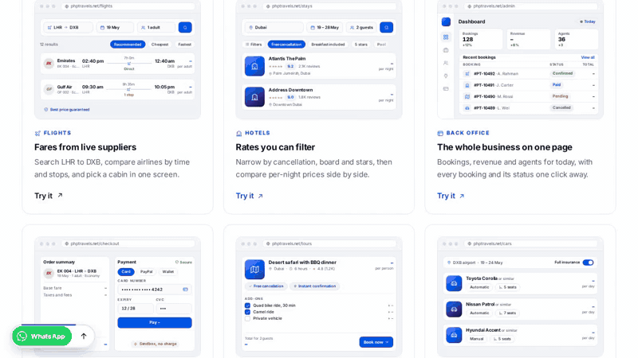

# TestScribe for VS Code

**Describe a browser test in Chat and get a checked result without leaving VS Code.** TestScribe shows the verdict, assertions, browser actions, and links to screenshots and reports. It uses the same Python CLI as the [main project](https://github.com/Tchaikovsky29/TestScribe).



*A live TestScribe run on PHPTravels: search DEL to PNQ and verify a visible “Book Now” button in the flight results.*

## Set up in your web project

The extension needs Python 3.10+, cURL, Playwright Chromium, and a model API key. It does not bundle them. Open your web project in VS Code and create a `.venv` there:

```bash
python3 -m venv .venv
source .venv/bin/activate
python -m pip install "git+https://github.com/Tchaikovsky29/TestScribe.git"
python -m playwright install chromium
```

On Windows, use `py -3 -m venv .venv` and `.venv\Scripts\activate`. If Chromium reports missing Linux system libraries, run `python -m playwright install --with-deps chromium`. TestScribe finds `testscribe` in the workspace `.venv` automatically. If you installed it elsewhere, set `testscribe.cliPath` to the executable path.

Install the TestScribe extension from the VS Code Marketplace, or use **Extensions: Install from VSIX...** with a [preview release](https://github.com/Tchaikovsky29/TestScribe/releases) while the Marketplace listing is being prepared. Then:

1. Open **Settings → Extensions → TestScribe** and choose **TestScribe: Provider**: BharatCode, Gemini, Groq, or Custom.
2. Add the matching API key to your web project's `.env` (`BHARATCODE_API_KEY`, `GEMINI_API_KEY`, or `GROQ_API_KEY`), or run **TestScribe: Set API Key** to keep it in VS Code Secret Storage. The extension never sends a stored key to its chat webview.
3. Open the TestScribe activity bar icon. Choose a model, enter a full `http://` or `https://` URL, and write a test that includes the expected result. Press **Run** or **Enter**.

When a key is available, the model picker loads IDs from the provider's `/models` endpoint. If the list cannot load, the preset's default model remains available. For **Custom**, set `testscribe.baseUrl` in Settings and type the model ID in Chat. `testscribe.apiKeyEnv` can override the key name.

Try this case on a public form:

```text
URL:  https://www.selenium.dev/selenium/web/web-form.html
Test: Enter TestScribe into the Text input field, submit the form, and verify that Received! appears.
```

The chat shows `PASS` only when Playwright verifies the requested result. `FAIL` means an action or check failed; `BLOCKED` means the run could not be completed reliably. Use **Open full report** for the plan, steps, checks, and evidence paths.

## Save and review cases

Use **Save** in Chat to create `.testscribe/<name>.json` in your web project. Run it again with **TestScribe: Run Test Case** from its editor or Explorer context menu. This is a simple JSON case:

```json
{
  "url": "https://www.selenium.dev/selenium/web/web-form.html",
  "test": "Enter TestScribe into the Text input field, submit the form, and verify that Received! appears."
}
```

Reports and artifacts are kept in VS Code's extension storage, outside your workspace. Passing runs save a screenshot by default; turn off `testscribe.passScreenshot` to skip it. Set `testscribe.headed` to watch Chromium while a run executes.

A case may reference an ignored `vars_file` for credentials. Prefix sensitive variable names with `_`; the Python runner substitutes those values locally, redacts exact matches in model requests and reports, and skips screenshots, traces, and video for those runs unless you opt in. See the [main README](https://github.com/Tchaikovsky29/TestScribe#test-flows-that-need-credentials) for the format and limits.

## Build from source

```bash
cd vscode-extension
npm ci
npm run package
```

The generated `.vsix` can be installed with **Extensions: Install from VSIX...**. For the CLI and complete execution flow, see the [main README](https://github.com/Tchaikovsky29/TestScribe) and [approach and limitations](https://github.com/Tchaikovsky29/TestScribe/blob/main/approach-and-limitations.md).
